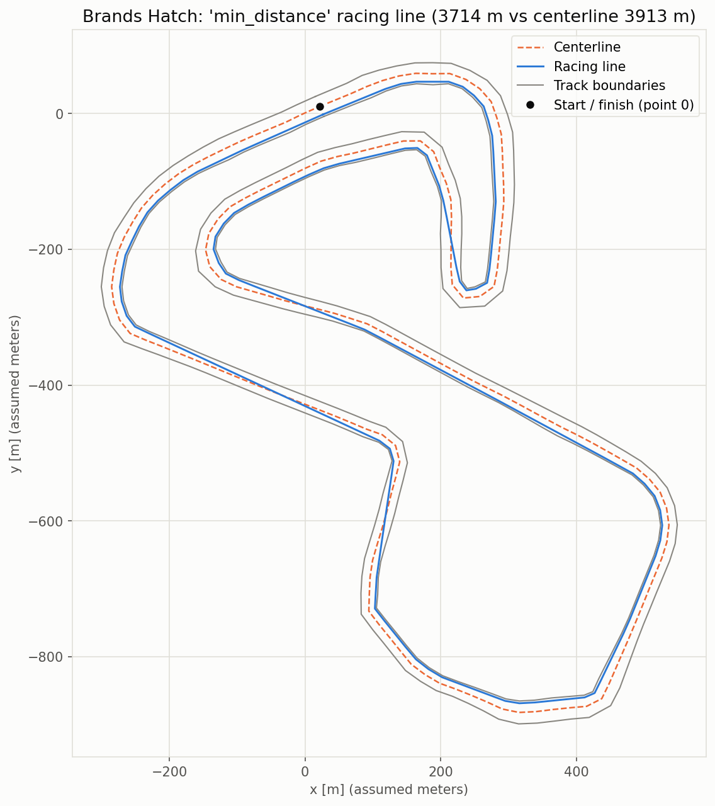
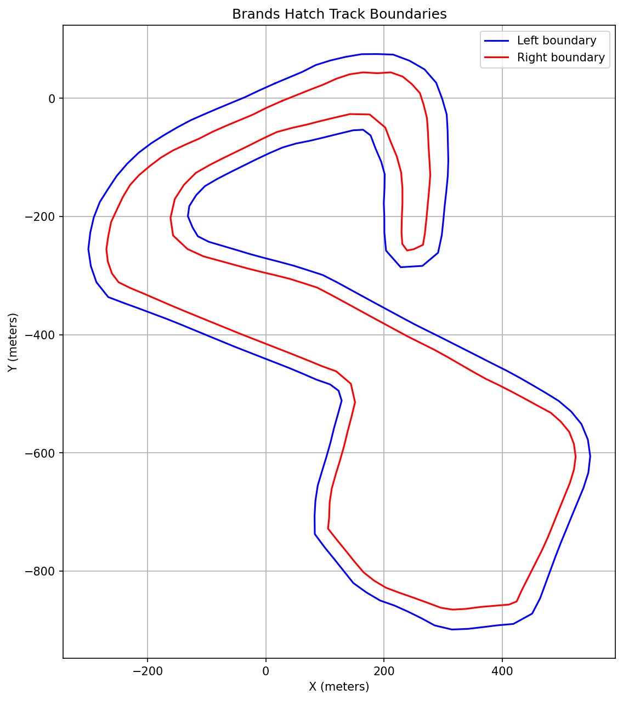
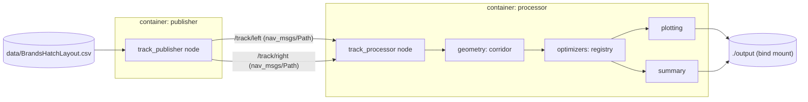

# Brands Hatch racing line: a two-container ROS 2 pipeline

Home assignment for BGRacing Autonomous.

A **publisher** container reads the Brands Hatch track boundaries from a CSV file and publishes them over ROS 2. A **processor** container receives them, computes the **centerline** and a **racing line**, and writes a plot, a run summary and logs to `./output`.



*Blue: the `min_distance` racing line (3714 m). Orange dashed: the centerline (3913 m). Gray: the track boundaries. Units are assumed to be meters.*

## Quick start

Requirements: Docker with Compose v2. Nothing else is needed.

```bash
git clone <this repository>
cd <repository folder>
docker compose up --build
```

The first build downloads the `ros:jazzy` base image (about 900 MB; the finished image is about 1.2 GB), so it takes a few minutes. A few seconds after the containers start you will see this line from the processor, and the results appear in `output/`:

```
processor-1  | ... [track_processor]: Saved run summary to /output/run_summary.json
```

The publisher keeps republishing the track forever (see [Design decisions](#design-decisions)), so stop the run with `Ctrl+C` and then run `docker compose down`.

| Output | What it is |
|---|---|
| `output/racing_line_<optimizer>.png` | Boundaries, centerline and racing line |
| `output/run_summary.json` | Optimizer and settings, point counts, lengths, `alpha` range, time per stage |
| `output/logs/publisher/*.log`, `output/logs/processor/*.log` | ROS log files of each node |

Notes:
- Console lines can be shown with readable times: `docker compose logs --timestamps`. ROS log lines themselves look like `[INFO] [1794414974.064686524] [track_processor]: ...`. The second bracket is Unix time (seconds since 1970-01-01 UTC), and ROS cannot print a calendar date. `run_summary.json` has an ISO UTC timestamp.
- On Linux the `output/` folder is created by Docker, so its files are owned by root.
- Configuration is copied into the image at build time. After editing `config/params.yaml`, run `docker compose up --build` again.

## Dataset: `BrandsHatchLayout.csv`

The file holds the left and right edges of the Brands Hatch Grand Prix circuit.

| Property | Value |
|---|---|
| Columns | `x`, `y`, `side` (`left` or `right`) |
| Rows | 314: 157 left and 157 right |
| Blank rows | 1 per side (empty `x` and `y`); removed while loading |
| Usable points | **156 per side**, 312 in total |
| x range | −300.2 to 548.6 (849 wide) |
| y range | −898.9 to 74.8 (974 high) |
| Units | Not stated in the file. **Assumed meters**: the centerline is about 3.9 km long, which fits the real circuit |
| Spacing between neighbouring points | mean 25.7 m on the left edge and 24.5 m on the right edge; range 11.8 to 37.4 m (irregular) |
| Loop | Closed. The last point is **not** repeated at the end; the gap from the last point back to the first is 30.5 m (left) and 29.5 m (right), an ordinary step |
| Pairing | Left point `i` and right point `i` are across from each other. For all 156 left points, the nearest right point has the same index |
| Road width | min 22.8 m, mean 27.6 m, max 35.7 m |
| Boundary lengths | left 4010.6 m, right 3818.5 m (the left edge is mostly the outside of the turns) |



*The raw boundaries. The CSV does not repeat the first point at the end, so the plot draws the closing segment (last point to first point) of each edge.*

## Task

1. Compute the **centerline**: the midpoint of each left/right pair. Length: **3912.8 m**.
2. Compute a **racing line**: the centerline pushed sideways by an offset `alpha` per point.
   - `alpha = 0` is the centerline, `+1` the left boundary, `-1` the right boundary.
   - A point of the line is `center[i] + alpha[i] * lateral[i]`, where `lateral[i]` is half of the vector from the right to the left boundary point.
   - Because of this definition, "stay on the road" is simply `-1 <= alpha <= 1`.
3. Choose the algorithm that computes `alpha` with the `optimizer` parameter (see below).

## Architecture



Both containers use the **same image** (Ubuntu 24.04, ROS 2 Jazzy, Python 3.12, built from `docker/Dockerfile`). `docker-compose.yml` starts it twice with a different command, so they are two services on one Compose network, and ROS 2 discovers the peer automatically (DDS) with no addresses in the code.

## Pipeline blocks

| Block | File | Job |
|---|---|---|
| Publisher node | `src/publisher_node.py` | Loads the CSV once. Every `publish_period_s` seconds it publishes the left and right boundaries as two `nav_msgs/Path` messages |
| Processor node | `src/processor_node.py` | Collects both boundaries, then runs the pipeline **once** on the first complete pair. Logs the config at startup and the time of each stage |
| Geometry | `src/geometry.py` | `load_track` (read the CSV, drop non-finite rows), `compute_centerline`, `build_corridor`, `apply_offsets`, `path_length`. No ROS imports |
| Optimizers | `src/optimizers.py` | A registry of functions `optimizer(corridor, params) -> alpha`. No ROS imports |
| Plotting | `src/plotting.py` | Saves the PNG. No ROS imports |
| Summary | `src/summary.py` | Builds and writes `run_summary.json`. No ROS imports |

The algorithms are separate from the ROS nodes, so they are tested without ROS.

**Optimizers** (selected by the `optimizer` parameter):

| Name | `alpha` | Idea |
|---|---|---|
| `centerline` | 0 everywhere | Baseline |
| `min_distance` | computed | Shortest line inside the road. Minimizes the sum of **squared** segment lengths (a quadratic program with box limits on `alpha`). Solved with a small NumPy sweep solver: each point in turn moves to its best position given its two neighbours (a closed-form update), clipped to `±alpha_limit`, repeated until nothing moves more than `tolerance` |

To add an optimizer, write one function and decorate it with `@register("name")` in `src/optimizers.py`. Then set `optimizer: name` in the config. The nodes do not change.

## Configuration

All tunable values are ROS parameters in [`config/params.yaml`](config/params.yaml). The nodes declare their parameters **by type, without defaults in the code**, so a missing value stops the node at startup. Both nodes log the values they actually received at startup. The compose `command:` passes the file with `--ros-args --params-file`.

| Node | Parameter | Value | Meaning |
|---|---|---|---|
| `track_publisher` | `csv_path` | `/app/data/BrandsHatchLayout.csv` | Input file inside the container |
| | `publish_period_s` | `2.0` | Seconds between republishing the track |
| | `frame_id` | `map` | Frame name in the message headers |
| `track_processor` | `optimizer` | `min_distance` | `centerline` or `min_distance` |
| | `alpha_limit` | `0.8` | Largest `abs(alpha)`, the safety margin |
| | `max_iterations` | `200` | Largest number of solver sweeps |
| | `tolerance` | `0.000001` | The solver stops when no `alpha` changes by more than this |
| | `output_dir` | `/output` | Where results are written (mounted to `./output`) |

### The safety margin

`alpha_limit: 0.8` means the line may use 80% of the half-width of the road at each point. The margin to each edge is therefore **20% of the local half-width**: about 2.3 m where the road is narrowest (22.8 m wide) and about 3.6 m where it is widest (35.7 m). A limit of `1.0` would let the line touch the boundary, which a car with a width cannot do. The margin is a fraction, so it varies with the road width (see [Future work](#future-work)).

## Results

`min_distance` on the full lap (the centerline is 3912.8 m):

| `alpha_limit` | Line length | Shorter than centerline |
|---|---|---|
| 1.0 | 3666.2 m | 246.7 m (6.3%) |
| 0.9 | 3689.9 m | 222.9 m (5.7%) |
| **0.8 (default)** | **3713.9 m** | **199.0 m (5.1%)** |

About half of the points sit exactly at the limit: the shortest line hugs the inside of each turn.

Time per stage in one Docker run (from `run_summary.json`; this depends on the machine):

| Stage | Time |
|---|---|
| Centerline | 0.7 ms |
| Optimizer (`min_distance`) | 681 ms |
| Plot | 436 ms |

## Design decisions

- **Two topics of `nav_msgs/Path`** (`/track/left`, `/track/right`). It is a standard message type with float64 positions and a header. The processor waits until it has both sides, in either order.
- **Default QoS and periodic republishing.** With default QoS (volatile), a subscriber that starts late does not receive old messages, and ROS does not warn about it. So the publisher resends the track every `publish_period_s` seconds, and the processor uses the first complete pair and ignores the rest.
- **Registry for optimizers.** A new algorithm is a new function, not a change in the processor.
- **No defaults in code.** Every value comes from `params.yaml`, and an unknown optimizer name or a missing parameter stops the node at startup, not in the middle of a run.
- **Squared length instead of length.** The true length has square roots. For evenly spaced points the squared-length objective gives nearly the same line and turns the problem into a quadratic one. The unit tests check the solver on a circular road, where the answer is known: the inner edge.
- **Plain Python scripts, not a colcon package.** It keeps the project small. The nodes are started with `python3 src/<node>.py --ros-args --params-file ...`.

## Assumptions and limitations

- Units are assumed to be meters. The dataset does not state them.
- Left and right points are paired by index. This holds for this file, and `compute_centerline` stops with an error if the two sides have different lengths.
- The track is treated as a closed loop (indices wrap around).
- The `min_distance` line is the **shortest** line. It is not a fast line: there is no vehicle model, so tight corners are not penalized.
- The solver minimizes squared length, an approximation of the true length.
- The processor runs the pipeline once, on the first complete pair of messages.
- Timing numbers depend on the machine.

## Future work

- **Margin in meters.** Define the margin as a fixed distance (car half-width plus clearance) instead of a fraction, with a per-point limit of `1 - margin_m / half_width[i]`, so the clearance does not shrink on narrow sections.
- **Transient-local (durable) QoS.** It is the proper fix for the late-joiner problem: the publisher sends the track once and keeps it for late subscribers. It was not used because this project keeps the default QoS.
- **`min_curvature`:** minimize the squared curvature to get a smooth line with large radii.
- **Speed profile and `min_time`:** limit the speed in each turn by tire grip (`v = sqrt(mu * g / curvature)`), add acceleration and braking limits with a forward and a backward pass, and choose the line with the lowest lap time.

## Tests

```bash
pip install numpy matplotlib pytest
python -m pytest
```

15 tests cover loading, the centerline, path length, the optimizer registry, `min_distance` (including the circular road with a known answer), plotting and the summary. Run it from the repository root.

`python -m scripts.plot_track` draws the raw boundaries to `output/track_boundaries.png`.

## Repository layout

```
.
├── config/params.yaml        # all ROS parameters
├── data/BrandsHatchLayout.csv
├── docker/Dockerfile         # one image for both services
├── docker-compose.yml        # publisher and processor services, ./output bind mount
├── docs/images/              # images used in this README
├── scripts/plot_track.py     # plot the raw boundaries
├── src/                      # nodes and pure algorithms
│   ├── publisher_node.py
│   ├── processor_node.py
│   ├── geometry.py
│   ├── optimizers.py
│   ├── plotting.py
│   └── summary.py
├── tests/                    # pytest
└── output/                   # generated by `docker compose up` (not in git)
```
